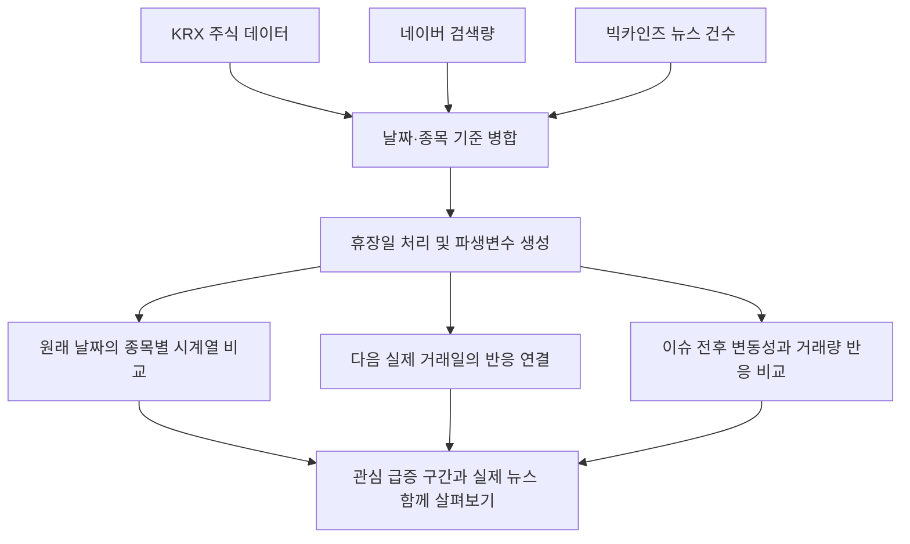
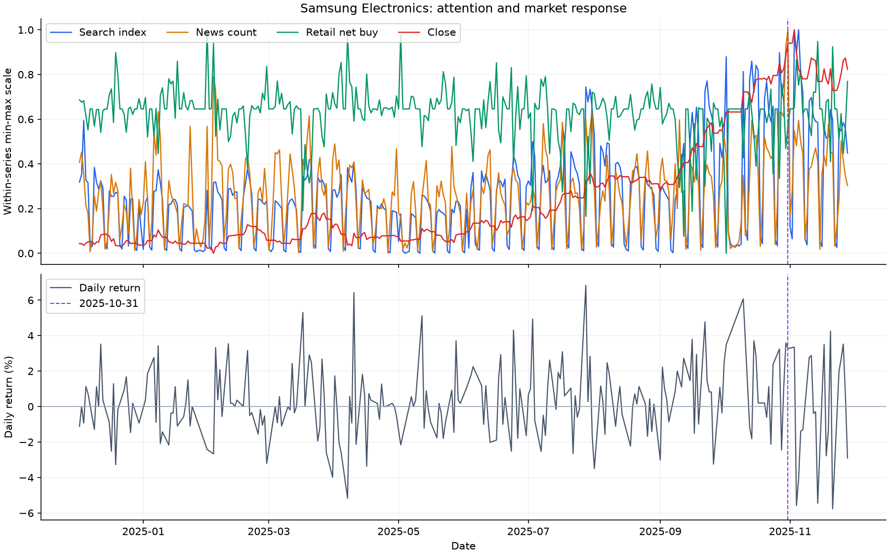

# 개인투자자의 FOMO 행동 패턴 분석

뉴스·검색 관심이 높아진 시점과 개인투자자의 매매·주가 반응을 종목별로 비교한 탐색적 데이터 분석(EDA) 수업 팀 프로젝트입니다.

- **핵심 질문:** 뉴스·검색 관심이 커진 뒤 개인 매매와 가격은 어떻게 움직이는가?
- **나의 역할:** 주제 변경 제안, 데이터 수집, 팀원과 전처리 공동 진행, Codex가 작성한 코드 실행 및 시각화 개선 방향 제시, 담당 보고서 작성
- **팀 규모:** 4명
- **분석 데이터 기간:** 2024년 12월~2025년 11월
- **주요 해결 과제:** 주말에도 발생하는 뉴스·검색 데이터를 다음 실제 거래일의 시장 반응과 연결
- **사용 도구:** Python, pandas, NumPy, Matplotlib, Seaborn, scikit-learn, Jupyter Notebook
- **대표 결과물:** [삼성전자 시계열](#4-대표-분석-사례), [핵심 변수 설명](docs/data_dictionary.md), [수정·검증 기록](docs/review_status.md)

> 수업 당시 분석과 2026-10-15 포트폴리오 정리 과정의 수정·재실행을 구분해 기록했습니다. 바로 실행하려면 [실행 방법](#7-실행-방법)을 참고하세요.

## 1. 왜 이 주제를 선택했는가

처음에는 스마트워크 관련 주제로 제안서를 작성했지만, 분석에 필요한 데이터를 확보하는 데 어려움이 있어 주제를 변경했습니다.

당시 큰 뉴스가 이어지고 주식시장의 변동이 눈에 띄는 상황에서, 저는 뉴스에서 자주 언급되던 FOMO에 관심을 가졌습니다. 뉴스가 나온 뒤 관심이 커지는 모습이 실제 개인투자자의 매매와도 연결되는지 확인하고 싶어 새로운 주제를 제안했습니다.

이 질문을 살펴보기 위해 종목별 뉴스 기사 건수, 검색량, 개인 매매와 주가를 같은 시간축에 놓고 비교했습니다. 분석 범위는 삼성전자, NAVER, 카카오, 현대차, 한화오션, 펄어비스, 에코프로, 셀트리온, LG에너지솔루션, 포스코퓨처엠 등 10개 종목입니다.

## 2. 데이터와 분석 방법

### 데이터 구성

| 출처 | 사용한 데이터 | 분석에서의 역할 |
|---|---|---|
| KRX | 종가, 등락률, 거래량, 개인 매수·매도·순매수 등 | 가격과 매매 반응 비교 |
| 네이버 데이터랩 | 종목명 기반 검색량 지수 | 관심 변화의 대리 지표 |
| 빅카인즈(BigKinds) | 종목 관련 일별 뉴스 기사 건수 | 보도량과 이슈 발생 시점 탐색 |

출처 명칭은 발표자료와 분석 노트북의 입력 파일을 기준으로 정리했습니다. 분석 노트북에서는 수집된 Excel 파일을 불러옵니다. 발표자료의 월 단위 범위는 2024년 12월~2025년 11월이며, 확인된 주식 데이터의 첫 거래일과 마지막 거래일은 2024-12-02와 2025-11-28입니다.

### 분석 흐름



1. 종목별로 나뉜 뉴스·검색 자료를 날짜와 종목 기준으로 병합할 수 있는 형태로 변환했습니다.
2. 주식 데이터가 없는 주말에도 뉴스·검색 자료를 유지했습니다. 원본 코드에서는 가격·보유량 성격의 값은 앞선 값을 이어 쓰고, 거래량·등락률·매매량의 결측치는 0으로 처리했습니다.
3. 뉴스·검색량을 결합한 이슈강도, 등락률 절댓값, 로그 거래량 등을 생성했습니다.
4. 검색량·뉴스 건수·개인 순매수·종가를 정규화해 시계열로 비교하고, 급증 구간을 표시했습니다.
5. 이슈강도와 다음 거래일 반응의 관계, 이슈 발생 전후의 등락률·거래량을 탐색했습니다.
6. 이슈가 가장 강했던 날 주변의 수익률 변동성과 거래량 반응을 표준화해 K-means로 3개 군집을 나누는 분석도 진행했습니다. 정리본에서는 실제 거래일 기준 구간으로 수정하고, 군집화에 사용한 두 변수로 군집 수 평가를 다시 계산했습니다. 실루엣 점수는 K=2에서 더 높아 K=3을 최적값이라고 설명하지 않습니다.

## 3. 가장 어려웠던 문제: 주말 이슈를 언제의 시장 반응과 비교할 것인가

### 문제

뉴스와 검색 관심은 주말에도 발생하지만 주식시장은 휴장합니다. 주말을 제외하면 중요한 이슈가 사라지고, 날짜를 그대로 맞추면 같은 날의 시장 반응을 비교할 수 없었습니다.

### 해결 과정과 팀원의 기여

팀원 한 명이 제안한 `next_trade_date`를 전처리에 반영했습니다. 각 이슈 날짜 다음에 오는 실제 거래일을 지정하고, 그 거래일의 등락률과 거래량을 연결하는 방식입니다. 저도 이 처리를 반영해 전처리한 후 코드를 직접 실행했습니다.

예를 들어 월요일이 정상 거래일인 경우 다음과 같이 연결합니다.

| 이슈가 발생한 날짜 | `next_trade_date` | 비교할 시장 반응 |
|---|---|---|
| 2025-11-07 금요일 | 2025-11-10 월요일 | 월요일 등락률·거래량 |
| 2025-11-08 토요일 | 2025-11-10 월요일 | 월요일 등락률·거래량 |
| 2025-11-09 일요일 | 2025-11-10 월요일 | 월요일 등락률·거래량 |

원래 뉴스·검색 날짜는 유지됩니다. 토요일과 일요일의 뉴스 건수를 월요일 한 행에 합치는 방식이 아니라, 각각의 이슈 날짜에 다음 거래일의 반응을 붙입니다. 월요일이 휴장일이면 수집된 거래일 목록을 기준으로 그다음 실제 거래일과 연결합니다.

### 이 방식의 의미와 한계

휴장일 이슈를 보존하면서 다음 거래일의 반응을 함께 살펴볼 수 있었습니다. 다만 금요일부터 일요일까지 여러 날짜가 같은 월요일의 반응을 공유하므로, 각 행을 독립적인 사건처럼 해석하거나 이슈별 효과로 단정하지 않도록 주의해야 합니다.

## 4. 대표 분석 사례

### 삼성전자: 관심 급증 구간을 실제 뉴스와 연결해 해석

제가 가장 기억하는 사례는 삼성전자의 ‘깐부치킨 회동’ 관련 이슈입니다. 분석 노트북에는 2025-10-31자 관련 기사 기록이 남아 있습니다. 종목별 시계열에서 관심이 높아진 구간을 찾고, 당시 뉴스와 주가 움직임을 함께 살펴봤습니다.



*상단은 검색량·뉴스 건수·개인 순매수·종가를 각각 0~1 범위로 정규화한 그림입니다. 선의 높이는 실제 금액·수량이나 순매수의 양·음 부호를 직접 뜻하지 않습니다. 하단은 실제 일별 등락률(%)입니다. 점선은 분석 노트북에 기사가 기록된 2025-10-31입니다. [수업 발표 당시 그림](assets/samsung_flow.png)도 참고 자료로 남겼습니다.*

수집된 삼성전자 데이터에서 2025-10-31 종가는 107,500원, 당일 등락률은 +3.27%, 거래량은 직전 20거래일 평균의 약 2.27배입니다. 이 사례는 뉴스·검색 관심과 주가 움직임이 같은 시기에 관찰되는 구간을 해석한 경험입니다. 일별 자료만으로 기사의 공개 시각과 장중 반응의 순서를 구분할 수 없으므로, 해당 뉴스가 상승의 원인이었다고 결론 내리지는 않습니다.

정리본의 검색 급증–순매수 급증 연결 규칙에서는 삼성전자 검색 급증 20건 중 연결된 순매수 급증이 0건이었습니다. 이는 사용한 임계값·관찰 구간에서의 결과입니다. **관심·가격 상승을 개인 순매수 증가나 FOMO의 입증과 같은 의미로 해석하지 않는 것**이 이 사례를 다시 살펴보며 확인한 핵심입니다.

### 관심과 다음 거래일 반응의 관계

금요일·주말 이슈가 같은 월요일 반응을 공유하는 문제를 고려해, 같은 반응 거래일에 연결된 이슈강도의 평균을 구한 뒤 종목별 상관계수를 계산했습니다. 종목마다 반응 거래일 240개를 비교했습니다.

| 비교 대상 | 10개 종목의 피어슨 상관계수 범위 |
|---|---|
| 이슈강도 평균과 다음 거래일 등락률 | 약 -0.144~0.094 |
| 이슈강도 평균과 다음 거래일 로그 거래량 | 약 0.139~0.382 |

이 표에서는 가격 방향보다 거래량과의 관계가 상대적으로 더 뚜렷했습니다. 시간에 따른 추세와 다른 시장 요인을 통제하지 않은 기술적 비교이며, 예측력이나 인과관계를 뜻하지 않습니다. 원자료별 수치는 [반응 상관계수](results/reaction_correlations.csv)에 있습니다.

### 추가 시도: 탐색용 FOMO 지표

별도 실험 노트북에서는 뉴스량·검색량·매매량의 변동성과 두 시계열의 시차 관계값을 결합한 `FOMO_Index`도 계산했습니다. 관측하기 어려운 심리적 개념을 수치로 표현하려는 탐색이었습니다.

이 실험은 최종 노트북의 `이슈강도`와 다른 계산입니다. 정리본에서는 순매수 열 선택, 상관계수 계산과 시차 방향, 반응 중복 집계를 수정했습니다. 수정한 지표는 현재 10개 종목 사이의 상대 비교용 값이며, 심리 측정이나 예측 성능이 검증된 지표로 제시하지 않습니다. 계산 의도와 변경 사항은 [수정·검증 기록](docs/review_status.md)에 설명했습니다.

## 5. 나의 역할과 협업 방식

| 구분 | 수행 내용 |
|---|---|
| 주제 제안 | 스마트워크 주제의 데이터 수집 어려움 이후, 뉴스·관심·개인 매매의 관계를 탐색하는 주제로 변경 제안 |
| 데이터 수집 | 분석에 필요한 주식·관심 자료 수집 참여 |
| 전처리 | 다른 팀원 한 명과 공동 진행, 다음 거래일 연결이 반영된 전처리 후 코드 실행 |
| 분석과 시각화 | Codex가 주로 작성한 코드를 직접 실행하고, 결과를 보며 시간 흐름과 주요 지점을 보여주는 그래프 수정 방향 제시 |
| 보고서 | 본인이 맡은 부분 작성 |
| 팀원의 해결 기여 | `next_trade_date`를 이용한 날짜 연결 방식을 팀원이 제안 |

코드 작성에는 **Codex를 활용**했습니다. 저는 주제와 분석 방향을 제안하고 데이터를 준비했으며, 생성된 코드를 실행한 결과를 바탕으로 그래프를 다듬었습니다. 전처리와 보고서 작성은 팀원들과 나누어 수행했습니다.

위 역할은 수업 당시의 경험입니다. 이번 포트폴리오 정리 과정의 코드 수정, 재실행과 문서화도 Codex를 활용해 진행했으며, 과제 이후 보완한 내용은 별도로 기록했습니다.

## 6. 배운 점과 다음 분석 방향

초기에는 FOMO가 주식시장 움직임을 크게 설명할 수 있다고 생각했습니다. 뉴스·검색 관심 증가와 주가 상승이 함께 나타나는 사례를 살펴봤지만, 이를 시장 전체로 일반화하기 어렵다는 점을 느꼈습니다.

주가에 영향을 주는 다양한 요인을 함께 고려해야 하며, 뉴스·검색 기반 관심 지표는 그중 하나의 분석 변수 후보로 다룰 수 있다고 생각하게 됐습니다. 또한 시계열을 비교할 때에는 그래프를 그리기 전에 **각 데이터가 발생하는 날짜와 거래일 기준을 맞추는 과정**이 중요하다는 점을 배웠습니다.

다음 분석에서는 다음을 확인하고 싶습니다.

- 시장 전체와 업종의 움직임을 함께 고려해, 관심 지표가 추가로 설명하는 부분이 있는지 비교
- 호재·악재 등 뉴스의 성격과 단순 보도량을 구분
- 휴장일 이슈의 집계 방법을 달리했을 때 결과가 얼마나 달라지는지 비교
- 예측에 활용할 경우 시간 순서로 나눈 데이터에서 지표의 유효성과 미래 정보 사용 여부 검증

## 7. 실행 방법

Python 3.12에서 확인했습니다. 저장소에 포함된 CSV로 실행하며 API 키는 필요하지 않습니다.

```bash
git clone https://github.com/HCG0313/stock-news-fomo-eda-portfolio.git
cd stock-news-fomo-eda-portfolio
python -m venv .venv
```

Windows PowerShell에서는 `.venv\Scripts\Activate.ps1`, macOS·Linux에서는 `source .venv/bin/activate`로 환경을 활성화합니다.

```bash
python -m pip install -r requirements.txt
python src/fomo_eda.py
python -m unittest discover -s tests -v
```

분석을 실행하면 `results/`에 다음 결과가 생성됩니다.

| 파일 | 내용 |
|---|---|
| `daily_panel.csv` | 주말 포함 일별 데이터, 실제 거래일 여부, 다음 거래일 반응 |
| `reaction_correlations.csv` | 반응 거래일로 묶어 비교한 종목별 상관계수 |
| `event_responses.csv`, `cluster_diagnostics.csv` | 이벤트 전후 반응과 군집 수 진단 |
| `fomo_features.csv` | 수정한 탐색용 지표의 구성값과 시차별 상관계수 |
| `spike_pair_details.csv`, `spike_pair_summary.csv` | 검색 이벤트별 최초 반응과 집계 결과 |
| `summary.json`, PNG 3개 | 입력 해시·실행 환경·검증 요약과 그래프 |

## 8. 결과 해석과 재현 범위

- 이 프로젝트는 뉴스·관심·시장 반응의 관계를 탐색한 수업 과제입니다. 가격 예측 성능이나 투자 수익률을 검증한 결과는 제시하지 않습니다.
- 분석한 10개 종목과 기간에 한정된 관찰이며, 개인투자자의 심리를 직접 측정한 자료는 없습니다.
- `등락률_next`와 `거래량_log_next`는 이후 시장 반응을 비교하기 위한 값입니다. 예측 모델의 입력으로 사용하려면 미래 정보가 들어가지 않도록 구분해야 합니다.
- 정리본은 원본 코드, 발표자료와 작성자의 회고를 대조하고, 동봉한 CSV에서 처음부터 실행했습니다. 주식 2,410행과 뉴스·검색 3,620행을 사용했으며, 거래일 연결·중복 집계·시차 방향 등을 확인하는 테스트 7개가 통과했습니다.
- `archive/`에는 수업 당시 노트북의 출력과 개인 PC 경로를 제거한 참고본이 있습니다. 그 코드의 계산 문제까지 수정한 것으로 소급해 설명하지 않습니다.
- 포함된 CSV 이후의 분석은 재실행할 수 있습니다. 외부 서비스에서 자료를 처음 수집하는 과정은 수집 코드·검색 조건 일부가 확인되지 않아 전체 자동 재현 범위에 포함하지 않았습니다. [데이터 출처와 범위](data/README.md)를 참고하세요.
- 급증 기준과 정규화 범위는 전체 관찰 기간에서 계산한 사후 분석 기준입니다. 미래에 적용 가능한 예측 규칙으로 검증하지 않았습니다.

상세 설명: [핵심 변수](docs/data_dictionary.md) · [확인된 문제와 남은 검증](docs/review_status.md)
